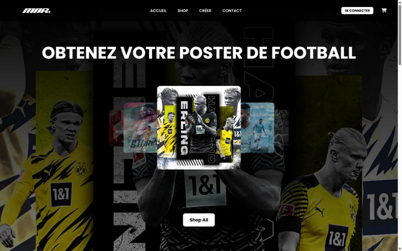
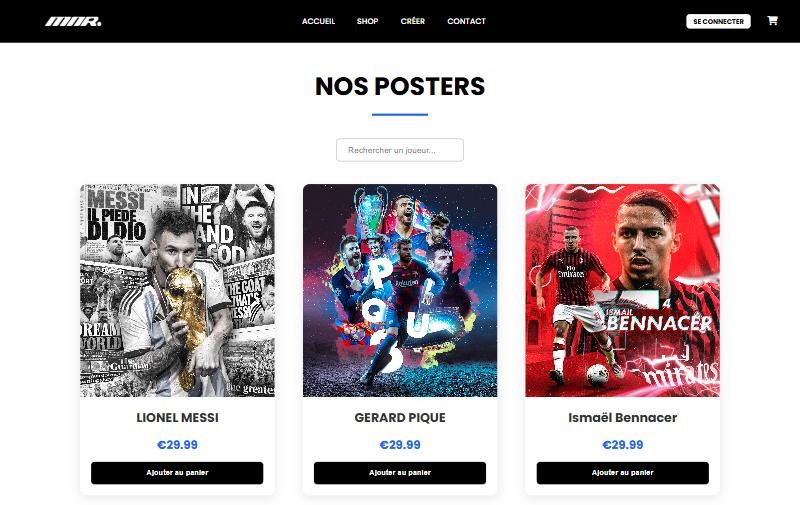

# MNR Posters

**A responsive e-commerce front end for a football poster shop**, built from scratch with HTML, CSS and vanilla JavaScript. Customers can browse posters, search by player, add posters to a cart, and send a request for a custom poster.

🔗 **Live demo:** [devm0unir.github.io/MNRposters](https://devm0unir.github.io/MNRposters/)


| Home | Shop |
|:---:|:---:|
|  |  |

## Features

- **Landing page**: interactive 3D carousel (Materialize) that changes the hero background, a looping video section, and a best-sellers grid with a hover effect that shows the framed version of each poster.
- **Product catalogue** with live search by player name.
- **Product detail page** filled dynamically from URL query parameters, with an image gallery (poster / framed mock-up).
- **Shopping cart** saved in `localStorage`, so it persists across pages and visits, plus toast notifications on add-to-cart.
- **Custom poster request form**: size, reference images, colors, elements to include, and detailed requirements.
- **Sign-in and registration pages** with client-side validation.
- **Responsive layout** for desktop, tablet and mobile.

## Tech stack

| | |
|---|---|
| Markup & styling | HTML5, CSS3 (Flexbox, Grid, media queries, transitions) |
| Scripting | Vanilla JavaScript (DOM manipulation, events, `localStorage`, `URLSearchParams`), jQuery |
| UI libraries | Materialize (carousel), Font Awesome (icons) |
| Deployment | GitHub Actions workflow that publishes the site to GitHub Pages on every push to `main` |

## Project structure

```
├── index.html              # Landing page
├── content/
│   ├── produits.html       # Catalogue + search
│   ├── produitdetail.html  # Product detail
│   ├── panier.html         # Cart
│   ├── create.html         # Custom poster request
│   ├── auth.html           # Sign in
│   └── inscrip.html        # Registration
├── javascript/script.js    # Search, cart and navigation logic
├── styles/                 # One stylesheet per page
├── images/  videos/        # Poster artwork, mock-ups and media
└── .github/workflows/      # GitHub Pages deployment
```

## Run locally

No build step or dependencies: clone the repository and open `index.html` in a browser, or serve the folder:

```bash
git clone https://github.com/devm0unir/MNRposters.git
cd MNRposters
python -m http.server 8000   # then open http://localhost:8000
```

## Scope and next steps

This is a front-end project: there is no server, so the cart and user accounts are simulated in the browser with `localStorage` and no real payment or order is processed. Natural next steps would be a back-end API with real authentication, a database for products and orders, and a payment provider.

## Author

Mounir Nait — [github.com/devm0unir](https://github.com/devm0unir)
